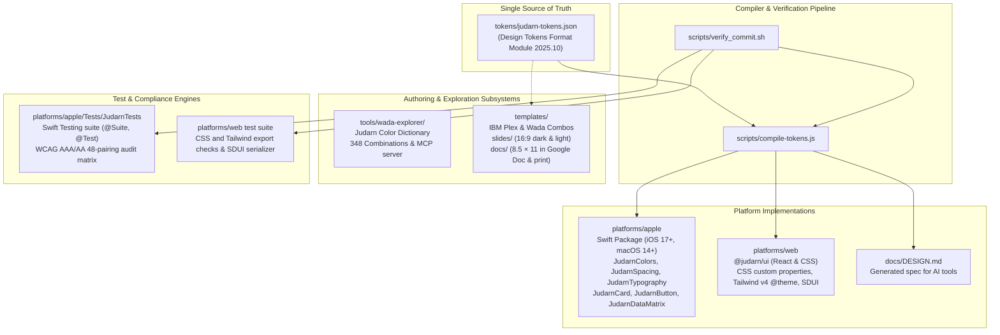

# Architecture & System Topology

## Overview
`Judarn` is a personal design system: general rules for anything visual or designed, plus rules per host. This monorepo holds those rules, the design tokens compiled into Apple Native (iOS/macOS) and web (React/CSS) packages, and local variants for hosts that cannot use them.

## System Boundaries & Subsystems

### Domain Subsystem Contract Matrix

| Subsystem / Directory | Target Role | Positive Invariants | Negative Boundaries |
| :--- | :--- | :--- | :--- |
| `tokens/` (`judarn-tokens.json`) | Cross-platform compilers & AI coding tools | Design Tokens Format Module 2025.10 files resolved through `judarn.resolver.json`; single source of truth for color, space, and typography across Apple and web. | Zero host-specific runtime overrides; no direct manual modification of compiled output files. |
| `templates/` (`slides/`, `docs/`) | Document authors & presentation designers | Self-contained starters using IBM Plex and Sanzo Wada harmonies; sized for 16:9 slides and 8.5 × 11 in letter format. | Outside the compiled token pipeline; changes never force token updates or general rule revisions. |
| `tools/wada-explorer/` | Color explorers & MCP clients | Standalone OKLCh palette explorer for 348 Sanzo Wada harmonies; zero-dependency stdio MCP server for AI tools. | Optional add-on; core Judarn contrast guarantees and substrate identity do not depend on Wada themes (ADR-0007). |
| `docs/profiles/` | Project contributors | Single-file override records capturing explicit owner departures from Judarn defaults. | Profiles depend on Judarn, never the reverse; departures apply only to the project that declares them. |

### Core Topologies & Subsystems

- **Canonical Tokens & Compiler Pipeline (`tokens/judarn-tokens.json`, `tokens/judarn.resolver.json`, `scripts/lib/design-tokens.js`, `scripts/compile-tokens.js`)**: Design Tokens Format Module 2025.10 files (`judarn-tokens.json` foundation, `modes/*.tokens.json` colour contexts, `judarn.resolver.json` resolver) specifying color registers (OKLCh dual-tier & 4-quadrant high contrast), spatial scales (8/4 grid), reading measures (`65ch`, `45ch`, `260pt` sidebar), border widths, and corner radii. The compiler translates the schema into Swift, CSS, Kotlin, and emits the `docs/DESIGN.md` specification for AI coding tools. `--check` fails on drift.
- **Judarn Color Dictionary & MCP Server (`tools/wada-explorer/`, `tokens/judarn-tokens.json`)**: Optional add-on, outside Judarn's core identity and contrast guarantees. Curated Japanese color harmonies derived from Sanzo Wada's 1930s dictionary (*Haishoku Sōkan*), defined in OKLCh for digital screens. Includes the 348-combination gallery landing view, live multi-context previewer across slides, specifications, app mockups, and web heroes, and a zero-dependency Model Context Protocol (MCP) server for AI coding assistants.
- **Project Profiles (`docs/profiles/`)**: One file per project recording only what it changes from Judarn's defaults, with the overrides the owner approved. Profiles depend on Judarn, never the reverse.
- **Claude Artifact Copy (`docs/claude-artifact/`)**: Source of the `project/README.md` and `project/wada.md` files in Judarn's Claude design system artifact, which Claude reads because it cannot read this repository.
- **Presentation & Document Starter Templates (`templates/`)**: Local variants of Judarn, outside the token pipeline and the general rules. Authoring starters for tools that need fonts and colors chosen beforehand, using **IBM Plex** typography (IBM Plex Sans & IBM Plex Mono) and Sanzo Wada color harmonies:
  - `templates/slides/`: 16:9 presentation slide templates covering dark focus headline and light technical data archetypes with balanced vertical symmetry, tabular numeric alignment, and zero default numbering noise.
  - `templates/docs/`: 8.5 × 11 in vertical letter specification template for group projects, milestone tracking, and architecture decisions, copy-pasteable into Google Docs and sized for PDF export.
- **Apple Native (`platforms/apple`)**:
  - Swift package target exported via root `Package.swift(name: "Judarn")`.
  - Swift Package Index (SPI) manifest (`.spi.yml`) configuring automated builder and DocC documentation targets.
  - DocC documentation catalog (`platforms/apple/Sources/Judarn/Judarn.docc`) and a manual DocC build workflow (`.github/workflows/documentation.yml`, `workflow_dispatch` only).
  - Color Tokens & Contrast Engine (`JudarnColors.swift`, `JudarnContrastVerifier.swift`): Dual-tier OKLCh color models, Display P3 gamut support, dynamic light/dark trait adaptation, mathematical WCAG 2.1/2.2 AAA/AA relative luminance verification.
  - Typography (`JudarnTypography.swift`): Pluggable font slots (`JudarnFontConfig`), semantic `Font.TextStyle` mapping with native platform density, tracking calibration, reading measure limits, tabular numeric data formatting.
  - Layout & Radii (`JudarnSpacing.swift`): 8/4 spatial grid, continuous squircle radii (`JudarnRadius`).
  - Components (`JudarnButton.swift`, `JudarnCard.swift`, `JudarnDataMatrix.swift`): Accessible tabular matrices, HIG touch target compliance, VoiceOver rotor navigation.
  - Test Suite (`Tests/JudarnTests/`): Swift Testing suite (`import Testing`, `@Suite`, `@Test`) covering color conversions, contrast verifier matrix, spatial rhythm, dynamic type, and component layouts.
- **web (`platforms/web`)**:
  - `@judarn/ui` package with React components compiled by esbuild to ESM and CommonJS in `dist/` ([ADR-0011](docs/adr/0011-web-package-ships-compiled-javascript.md)), CSS custom properties (`styles/colors_and_type.css`), Tailwind CSS v4 `@theme` preset, and a Server-Driven UI (SDUI) serializer that validates an allowlist of props per node type.
  - Component, SDUI, and CSS tests render the built `dist/` with `react-dom/server`.
  - Distribution packaging hygiene via explicit `files` whitelist, verified locally via `npm pack --dry-run` and `scripts/verify-consumption.js`.
- **Cross-Platform Tooling (`scripts/`)**:
  - Cross-platform token version synchronization CLI (`scripts/sync-version.js`) enforcing version alignment across package manifests and documentation.
  - External consumption contract test engine (`scripts/verify-consumption.js`) verifying package export maps, symbol manifests, and distribution readiness.
  - ADR governance gate (`scripts/verify-adrs.js`) enforcing the four-heading record format and index parity, run by the `pre-commit` hook and `scripts/verify_commit.sh`.

## Architecture Flow Diagram

## Invariants & Design Contracts

1. **Concurrency**: Swift 6 strict concurrency (`@MainActor`, `@Sendable`).
2. **Encapsulation**: Default to `public` only for exported token APIs and styles; internal helpers remain private.
3. **Platform Invariants**:
   - Judarn's rules are the owner's defaults: the owner's request and a project's profile win outside this repository, and Judarn's own code follows every rule.
   - Judarn binds to the host, anywhere the work lives. Judarn sets color, spatial rhythm, and typography. The host platform shapes geometry, depth, and touch mechanics.
   - **Shape**: Delegate corner radius to the host platform.
     - In SwiftUI: cards use `RoundedRectangle(cornerRadius: 16, style: .continuous)` (`JudarnRadius.card`), controls use platform-calibrated continuous corner radii (`JudarnRadius.subtle = 6pt` on macOS desktop; `JudarnRadius.control = 10pt` on iOS touch), and tags/badges use `Capsule()`. Never clip cards or controls with `Rectangle()`.
     - In CSS: cards use `var(--radius-card, 16px)`, controls use `var(--radius-control, 10px)`.
   - **Surface Hierarchy**: Distinguish surfaces by background fill contrast (`surfaceElevated` or a light accent tint on `substrate`; in light mode `substrate` is `#FFFFFF` and `surfaceElevated` is `#F8F8F8`). Never apply `.border(...)` or `.overlay(strokeBorder(...))` around card perimeters. Hairlines (`rule = 1pt`) belong only inside tabular matrices and data grids. Render elevated cards on native materials (`.regularMaterial`, `.ultraThinMaterial`, `backdrop-filter`) when available.
   - **Text Casing & Micro-Typography**: Set headers, titles, recommendation strings, and every control's own name (buttons, chips, toggles, segments) in sentence case or title case. A label inside a control keeps its role: a disclosure header that names its section is a section label with heading semantics and an expanded state, and an eyebrow or value label keeps its casing only when the control also shows the title or value it names. Uppercase is a label role: `label` and `micro` apply the host's case transform (`.textCase(.uppercase)`, `text-transform: uppercase`) only to eyebrows, section labels, column headers, and value labels of at most two words that hold no digit, unit symbol, or mixed-case term and are never the most prominent text in their block. Section labels keep heading semantics (`.isHeader`, `role="heading"`). Both styles take an as-written casing (`JudarnTextCasing.asWritten`, `.t-as-written`) that keeps size and weight with body tracking, for statuses, counts, values, units, and messages. Source strings carry their reading case; only acronyms and codes are capitalized in source. Judarn's own components follow the same rule: status badges and navigation links are set as written, and matrix and table column headers and text field labels take a casing option (`casing`, `labelCasing`) for protected tokens and longer labels. Mandatory positive tracking couples to uppercase labels (`+0.06em` on `label`, `+0.08em` on `micro`) paired with OpenType case-sensitive punctuation (`case 1`). Proportional lining figures serve as system default; tabular figures (`tnum`, `lnum`, `.monospacedDigit()`) govern matrices and metrics tables; old-style figures (`onum`) remain strictly opt-in for narrative editorial prose. Variable fonts enable automated optical sizing (`opsz auto`). Monospace fonts disable ligatures (`font-variant-ligatures: none`).
   - **Touch Feedback**: Retain native button highlights, bounded ripples, and spring responses. Never suppress platform touch feedback.
4. **Accessibility Contracts**: Tabular components preserve semantic containers (`.accessibilityElement(children: .contain)`), system and custom VoiceOver rotors, column coordinate hints, and mask decorative hairline rules (`.accessibilityHidden(true)`). Empty cells expose `"Empty"` accessibility values while preserving baseline height via zero-width spaces. Cards group composite hierarchies as landmark containers via `.accessibilityElement(children: .contain)` and `JudarnCard.accessibilityLabel`. Form fields link accessible names and validation hints (`.accessibilityLabel`, `.accessibilityHint`) to input controls while suppressing redundant sibling text labels.
5. **Contrast Compliance Contracts**: Primary ink (`ink100`) guarantees WCAG AAA (at least 7.0:1) across all substrates and appearances. Secondary ink (`ink60`) and signal red (`signalError`) guarantee WCAG AA (at least 4.5:1) in standard appearances and elevate to WCAG AAA ($\ge 7.0:1$) under high-contrast appearances. Verified continuously via `JudarnContrastVerifier.auditCoreMatrix()` and cross-platform token audit suites. `contrastingInk` selects absolute black or white by the perceptual crossover, favoring white over WCAG ratios by design, while `contrastingAccent` clamps by the WCAG crossover so that 4.5:1 stays reachable on every surface (ADR-0005).
6. **Apple Platform HIG Bindings & Upstream Maintenance**:
   - To streamline auditing when Apple updates its Human Interface Guidelines (e.g., annual WWDC releases), every code location directly binding to Apple platform norms is tagged with `// MARK: - [Apple HIG Alignment]`.
   - Grepping `grep -rn "Apple HIG Alignment" platforms/apple/` surfaces all platform-dependent assumptions:
     - **System Typography**: Semantic text style mapping (`Font.TextStyle`) and AppKit (`NSFont`)/UIKit (`UIFont`) preferred point size bridges. A role takes a macOS style (`appleTextStyleMacOS`) only where its own style would match a smaller role's size on macOS.
     - **Button Density**: Desktop push button height (20–22pt `.sm`, 28pt `.md`) vs iOS 44pt touch floors (`spaceTouch`).
     - **Control Metrics**: Desktop text field 24pt height and 6pt subtle corner radius vs iOS 44pt height and 10pt squircles.
     - **Grid Density**: Desktop tabular cell insets (8pt) vs touch cell insets (16pt).
     - **Tag Hierarchy**: Auxiliary keyword tags (`micro`, `.caption2`: 11pt iOS, 10pt macOS) rank strictly below status badges (`label`: `.footnote` 13pt on iOS, `.subheadline` 11pt on macOS).

## Architectural Decision Records

System architecture choices, token invariants, and platform boundaries are recorded as Markdown Architectural Decision Records in [`docs/adr/`](docs/adr/README.md):

- [ADR-0001: Design Tokens Are the Single Source of Truth](docs/adr/0001-design-tokens-are-the-single-source-of-truth.md)
- [ADR-0005: Compile-Time Contrast Checks and Gamut Mapping](docs/adr/0005-compile-time-contrast-checks-and-gamut-mapping.md)
- [ADR-0007: Sanzo Wada Dictionary, Explorer, and MCP Server](docs/adr/0007-sanzo-wada-dictionary-explorer-and-mcp-server.md)
- [ADR-0008: Agent Skill Lives Outside the Repository](docs/adr/0008-agent-skill-lives-outside-the-repository.md)
- [ADR-0011: Web Package Ships Compiled JavaScript](docs/adr/0011-web-package-ships-compiled-javascript.md)
- [ADR-0013: Apps Consume @judarn/ui from the Public npm Registry](docs/adr/0013-apps-consume-judarn-ui-from-the-public-npm-registry.md)
- [ADR-0014: Public Repository Starts from a Fresh History](docs/adr/0014-public-repository-starts-from-a-fresh-history.md)
