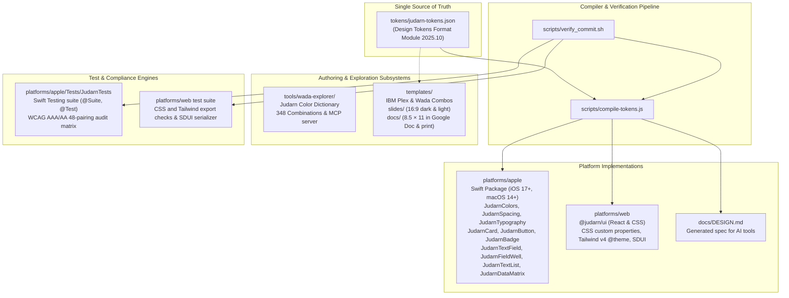

# Architecture & system topology

## Overview
`Judarn` is a personal design system: general rules for anything visual or designed, plus rules per host. This monorepo holds those rules, the design tokens compiled into Apple Native (iOS/macOS) and web (React/CSS) packages, and local variants for hosts that cannot use them.

## System boundaries & subsystems

### Domain subsystem contract matrix

| Subsystem / Directory | Target Role | Positive Invariants | Negative Boundaries |
| :--- | :--- | :--- | :--- |
| `tokens/` (`judarn-tokens.json`) | Cross-platform compilers & AI coding tools | Design Tokens Format Module 2025.10 files resolved through `judarn.resolver.json`; single source of truth for color, space, and typography across Apple and web. | Zero host-specific runtime overrides; no direct manual modification of compiled output files. |
| `templates/` (`slides/`, `docs/`) | Document authors & presentation designers | Self-contained starters using IBM Plex and Sanzo Wada harmonies; sized for 16:9 slides and 8.5 × 11 in letter format. | Outside the compiled token pipeline; changes never force token updates or general rule revisions. |
| `tools/wada-explorer/` | Color explorers & MCP clients | Standalone OKLCh palette explorer for 348 Sanzo Wada harmonies; zero-dependency stdio MCP server for AI tools. | Optional add-on; core Judarn contrast guarantees and substrate identity do not depend on Wada themes (ADR-0007). |
| `docs/profiles/` | Project contributors | Single-file override records capturing explicit owner departures from Judarn defaults. | Profiles depend on Judarn, never the reverse; departures apply only to the project that declares them. |

### Core topologies & subsystems

- **Canonical Tokens & Compiler Pipeline (`tokens/judarn-tokens.json`, `tokens/judarn.resolver.json`, `scripts/lib/design-tokens.js`, `scripts/compile-tokens.js`)**: Design Tokens Format Module 2025.10 files (`judarn-tokens.json` foundation, `modes/*.tokens.json` colour contexts, `judarn.resolver.json` resolver) specifying color registers (OKLCh dual-tier & 4-quadrant high contrast), spatial scales (8/4 grid), reading measures (`65ch`, `45ch`, `260pt` sidebar), border widths, and corner radii. The compiler translates the schema into Swift and CSS (including the Tailwind preset), and emits the `docs/DESIGN.md` specification for AI coding tools. `--check` fails on drift.
- **Judarn Color Dictionary & MCP Server (`tools/wada-explorer/`, `tokens/judarn-tokens.json`)**: Optional add-on, outside Judarn's core identity and contrast guarantees. Curated Japanese color harmonies derived from Sanzo Wada's 1930s dictionary (*Haishoku Sōkan*), defined in OKLCh for digital screens. Includes the 348-combination gallery landing view, live multi-context previewer across slides, specifications, app mockups, and web heroes, and a zero-dependency Model Context Protocol (MCP) server for AI coding assistants.
- **Project Profiles (`docs/profiles/`)**: One file per project recording only what it changes from Judarn's defaults, with the overrides the owner approved. Profiles depend on Judarn, never the reverse.
- **Claude Artifact Copy (`docs/claude-artifact/`)**: Source of the `project/README.md` and `project/wada.md` files in Judarn's Claude design system artifact, which Claude reads because it cannot read this repository. Its component guideline pages (`project/components/<Comp>/README.md`) come from `platforms/web/src/<Comp>/README.md`, one beside each web component, checked against the component's variants by `platforms/web/scripts/verify-unit.js`.
- **Presentation & Document Starter Templates (`templates/`)**: Local variants of Judarn, outside the token pipeline and the general rules. Authoring starters for tools that need fonts and colors chosen beforehand, using **IBM Plex** typography (IBM Plex Sans & IBM Plex Mono) and Sanzo Wada color harmonies:
  - `templates/slides/`: 16:9 presentation slide templates covering dark focus headline and light technical data archetypes with balanced vertical symmetry, tabular numeric alignment, and zero default numbering noise.
  - `templates/docs/`: 8.5 × 11 in vertical letter specification template for group projects, milestone tracking, and architecture decisions, copy-pasteable into Google Docs and sized for PDF export.
- **Apple Native (`platforms/apple`)**:
  - Swift package target exported via root `Package.swift(name: "Judarn")`.
  - Swift Package Index (SPI) manifest (`.spi.yml`) configuring automated builder and DocC documentation targets.
  - DocC documentation catalog (`platforms/apple/Sources/Judarn/Judarn.docc`) and a manual DocC build check (`.github/workflows/documentation.yml`, `workflow_dispatch` only, build-only: it publishes nothing).
  - GitHub Pages site (`.github/workflows/pages.yml`, source "GitHub Actions"): on pushes to `main` that change the explorer, its build script or the tokens, a build job fails if the committed explorer HTML is stale and uploads `site/` with `index.html` and a font folder; a separate deploy job publishes it once the upload is finished (if deploy fails, re-run only that job). The font is fetched at publish time from a pinned Offentlig release (version and sha256 are two env values at the top of the workflow; a mismatch fails the run), and the release's `LICENSE` is published beside it. Nothing is committed into this repository.
  - Color Tokens & Contrast Engine (`JudarnColors.swift`, `JudarnContrastVerifier.swift`): Dual-tier OKLCh color models, Display P3 gamut support, dynamic light/dark trait adaptation, mathematical WCAG 2.1/2.2 AAA/AA relative luminance verification.
  - Typography (`JudarnTypography.swift`): Pluggable font slots (`JudarnFontConfig`), `JudarnTypographyStyle.nsFont` for AppKit labels and fields on macOS, semantic `Font.TextStyle` mapping with native platform density, tracking calibration, reading measure limits, tabular numeric data formatting.
  - Layout & Radii (`JudarnSpacing.swift`): 8/4 spatial grid, continuous squircle radii (`JudarnRadius`).
  - Components (`JudarnButton.swift`, `JudarnBadge.swift`, `JudarnCard.swift`, `JudarnTextField.swift`, `JudarnFieldWell.swift`, `JudarnTextList.swift`, `JudarnDataMatrix.swift`): Accessible tabular matrices, HIG touch target compliance, VoiceOver rotor navigation.
  - Test Suite (`Tests/JudarnTests/`): Swift Testing suite (`import Testing`, `@Suite`, `@Test`) covering color conversions, contrast verifier matrix, spatial rhythm, dynamic type, and component layouts.
- **web (`platforms/web`)**:
  - `@judarn/ui` package with React components compiled by esbuild to ESM and CommonJS in `dist/` ([ADR-0011](docs/adr/0011-web-package-ships-compiled-javascript.md)), CSS custom properties (`styles/colors_and_type.css`), Tailwind CSS v4 `@theme` preset, and a Server-Driven UI (SDUI) serializer that validates an allowlist of props per node type.
  - Component, SDUI, and CSS tests render the built `dist/` with `react-dom/server`.
  - Distribution packaging hygiene via explicit `files` whitelist, verified locally via `npm pack --dry-run` and `scripts/verify-consumption.js`.
- **Cross-Platform Tooling (`scripts/`)**:
  - Cross-platform token version synchronization CLI (`scripts/sync-version.js`) enforcing version alignment across package manifests and documentation.
  - External consumption contract test engine (`scripts/verify-consumption.js`) verifying package export maps, symbol manifests, and distribution readiness.
  - Shared commit checks (`scripts/commit-checks`, the pinned commit-checks package) enforcing the four-heading decision-record format and index parity, link integrity, the release-tag guard, house style, and the secret, path and email scans, run by the hooks, `scripts/verify_commit.sh` and CI.
  - Consumer status (`scripts/consumers.js`): a read-only report on the apps that load Judarn. For each one it finds the pin without configuration (the `@judarn/ui` entry in `package-lock.json`; the `judarn` pin in `Package.resolved` with its requirement from `Package.swift`, `project.yml` or an Xcode project; or a local path, reported as unpinned), then compares the pinned tag with a target tag over only what that app loads (`platforms/apple/Sources` and `Package.swift` for Swift; `platforms/web/src`, `platforms/web/package.json` and `tokens/` for npm). A change is `none`, `code` or `visible`. Comment-only edits, the manifest `version` and `description`, and `description` strings in JSON count as none; type declarations and manifests are code only; any other change under `platforms/apple/Sources` or `platforms/web/src`, or any token value that differs, is visible. Token values are compared by compiling plain `git archive` snapshots of both tags through each tag's own `scripts/lib/design-tokens.js`. The command also checks whether the target is on npm and has a GitHub release (unknown when offline), the consumer's uncommitted changes, Markdown lines that name the old version, and repositories under the list's `scanRoot` that load Judarn but are not listed. `--page` writes a self-contained page with old and new swatches under `build/`. The list names private repositories, so it lives only in the gitignored `docs/private/consumers.json`. `--gate --to vX.Y.Z` prints only the JSON the commit-checks `roll-out` command reads, `{"<name>": {"decision": "go" | "hold", "reason": "..."}}`: `hold` when the change is `visible` or the app has any blocker (the reason names every cause, the change first), `go` when the change is `none` or `code`. It exits nonzero when it cannot decide (unknown tag, unreadable list), so the roll-out holds every app. The list opts in with a `gate` field: `"gate": ["node", "<path to judarn>/scripts/consumers.js", "--gate", "--to", "{tag}"]`; the roll-out replaces `{tag}` and runs it once. The page prints the local calendar date; `--json` keeps the UTC timestamp. The command never writes to a consumer.

## Architecture flow diagram

## Invariants & design contracts

1. **Encapsulation**: Default to `public` only for exported token APIs and styles; internal helpers remain private.
2. **Platform Invariants**: The rules themselves live in [`docs/DESIGN.md`](docs/DESIGN.md), the only copy of the contract (ADR-0001). This list says where each one is implemented.
   - **Shape**: corner radii are `JudarnRadius` on Apple (`card`, `control`, `subtle`, with continuous corners) and `--jd-radius-card`, `--jd-radius-control`, `--jd-radius-badge`, `--jd-radius-subtle` in CSS. Values come from the tokens.
   - **Surfaces, fields, buttons**: `judarnOnElevatedSurface` (set by `JudarnCard`) switches wells to the card fill on Apple. On web, `--jd-well` inside `.jd-card` does the same.
   - **Lists in cards**: `judarnInCard` (set by every `JudarnCard`, flat or not) gives `JudarnTextList` the compact measure on Apple, like `.jd-card .jd-list` on web.
   - **Web class names**: every component class in `platforms/web/styles/components.css` carries the `jd-` prefix (`jd-btn`, `jd-badge`, `jd-tag`, `jd-card`, `jd-field`, `jd-navbar`, `jd-footer`, `jd-table`, `jd-matrix`, `jd-lockup`, `jd-list`).
   - **Lists**: `jd-list` and `jd-list--plain` on web, `JudarnTextList` on Apple.
   - **Text casing**: `JudarnTextCasing.asWritten` on Apple and `.t-as-written` on web. The component options `casing` and `labelCasing` carry it into matrices, tables, and fields.
   - **Touch feedback**: native highlights and ripples are never suppressed.
3. **Accessibility Contracts**: Tabular components preserve semantic containers (`.accessibilityElement(children: .contain)`), system and custom VoiceOver rotors, column coordinate hints, and mask decorative hairline rules (`.accessibilityHidden(true)`). Empty cells expose `"Empty"` accessibility values while preserving baseline height via zero-width spaces. Cards group composite hierarchies as landmark containers via `.accessibilityElement(children: .contain)` and `JudarnCard.accessibilityLabel`. Form fields link accessible names and validation hints (`.accessibilityLabel`, `.accessibilityHint`) to input controls while suppressing redundant sibling text labels.
4. **Contrast Compliance Contracts**: Primary ink (`ink100`) guarantees WCAG AAA (at least 7.0:1) across all substrates and appearances. Secondary ink (`ink60`) and signal red (`signalError`) guarantee WCAG AA (at least 4.5:1) in standard appearances and elevate to WCAG AAA ($\ge 7.0:1$) under high-contrast appearances. Verified continuously via `JudarnContrastVerifier.auditCoreMatrix()` and cross-platform token audit suites. `contrastingInk` selects absolute black or white by the perceptual crossover, favoring white over WCAG ratios by design, while `contrastingAccent` clamps by the WCAG crossover so that 4.5:1 stays reachable on every surface (ADR-0005).
5. **Apple Platform HIG Bindings & Upstream Maintenance**:
   - To streamline auditing when Apple updates its Human Interface Guidelines (e.g., annual WWDC releases), every code location directly binding to Apple platform norms is tagged with `// MARK: - [Apple HIG Alignment]`.
   - Grepping `grep -rn "Apple HIG Alignment" platforms/apple/` surfaces all platform-dependent assumptions:
     - **System Typography**: Semantic text style mapping (`Font.TextStyle`) and AppKit (`NSFont`)/UIKit (`UIFont`) preferred point size bridges. A role takes a macOS style (`appleTextStyleMacOS`) only where its own style would match a smaller role's size on macOS.
     - **Button Density**: Desktop push button height (20–22pt `.sm`, 28pt `.md`) vs iOS 44pt touch floors (`spaceTouch`).
     - **Control Metrics**: Desktop text field 24pt height, 8pt side padding and 6pt subtle corner radius vs iOS 44pt height, 16pt side padding and 10pt squircles. `judarnFieldWell()` holds these for every field.
     - **Grid Density**: Desktop tabular cell insets (8pt) vs touch cell insets (16pt).
     - **Tag Hierarchy**: Auxiliary keyword tags (`micro`, `.caption2`: 11pt iOS, 10pt macOS) rank strictly below status badges (`label`: `.footnote` 13pt on iOS, `.subheadline` 11pt on macOS).

## Architectural decision records

System architecture choices, token invariants, and platform boundaries are recorded as Markdown Architectural Decision Records in [`docs/adr/`](docs/adr/README.md):

- [ADR-0001: Design tokens are the single source of truth](docs/adr/0001-design-tokens-are-the-single-source-of-truth.md)
- [ADR-0005: Compile-time contrast checks and gamut mapping](docs/adr/0005-compile-time-contrast-checks-and-gamut-mapping.md)
- [ADR-0007: Sanzo Wada dictionary, explorer, and MCP server](docs/adr/0007-sanzo-wada-dictionary-explorer-and-mcp-server.md)
- [ADR-0008: Agent skill lives outside the repository](docs/adr/0008-agent-skill-lives-outside-the-repository.md)
- [ADR-0011: Web package ships compiled JavaScript](docs/adr/0011-web-package-ships-compiled-javascript.md)
- [ADR-0013: Apps consume @judarn/ui from the public npm registry](docs/adr/0013-apps-consume-judarn-ui-from-the-public-npm-registry.md)
- [ADR-0014: Public repository starts from a fresh history](docs/adr/0014-public-repository-starts-from-a-fresh-history.md)
